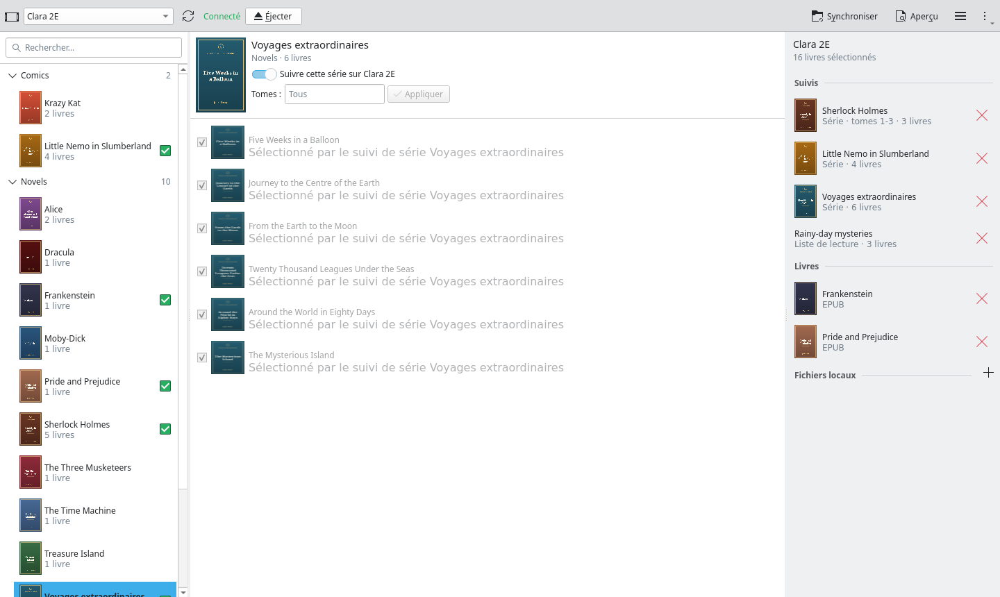
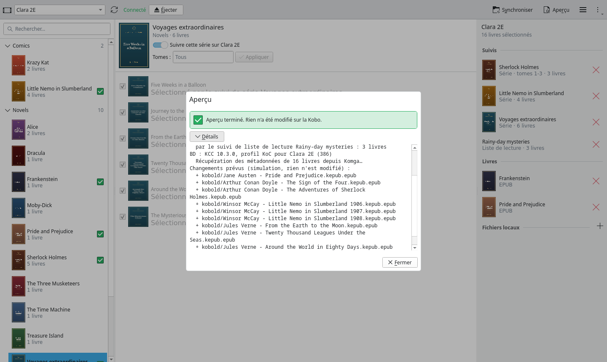
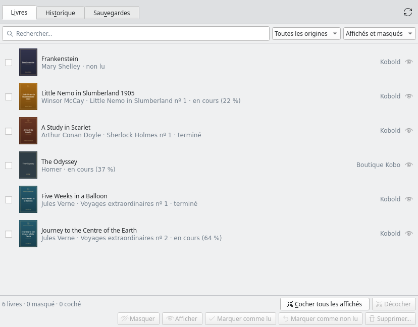
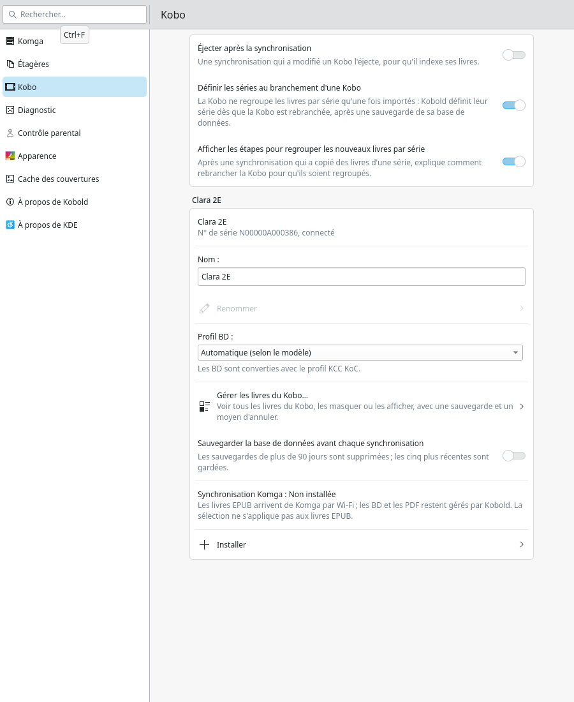

# Kobold

[](https://github.com/jstmichel/kobold/actions/workflows/ci.yml)
[](https://github.com/jstmichel/kobold/releases/latest)
[](LICENSE)

*English: [README.md](README.md)*



Kobold synchronise les livres d'un serveur [Komga](https://komga.org), et de dossiers à vous,
avec des liseuses Kobo branchées en USB. Les EPUB sont convertis en KEPUB avec
[kepubify](https://pgaskin.net/kepubify/), les bandes dessinées en KEPUB à mise en page fixe,
les PDF sont copiés tels quels, et la progression de lecture remonte de la Kobo vers Komga.

En option, Kobold configure aussi la synchronisation Kobo de Komga : les EPUB arrivent alors
par Wi-Fi, tandis que les BD et les PDF continuent de passer par l'USB.

Kobold parle français et anglais, selon la langue du système. Il existe en application de
bureau KDE (`kobold-gui`) et en ligne de commande (`kobold`).

## Ce qu'il fait

- **Bibliothèque** : bibliothèques, séries avec couvertures, collections et listes de lecture
  de Komga ; cochez des livres ou suivez une série entière (ou une plage de tomes) : les
  nouveaux tomes arrivent à la synchro suivante.
- **Étagères** : des dossiers de livres hors de Komga, avec éditeurs de métadonnées, choix de
  couverture et recherche en ligne.
- **Synchronisation** : aperçu sans rien modifier, synchro de la Kobo courante ou de toutes
  les Kobo branchées, séries regroupées dans la bibliothèque de la Kobo, envoi de la
  progression de lecture à Komga.
- **Livres sur la Kobo** : tous les livres que connaît la Kobo, à cacher, montrer, marquer ou
  supprimer, avec sauvegardes, historique et annulation.
- **Plusieurs Kobo**, chacune avec sa sélection, son nom et son profil BD ; **contrôle
  parental** par code.

| Aperçu d'une synchro | Livres sur la Kobo | Réglages d'une Kobo |
|---|---|---|
|  |  |  |

Les captures utilisent seulement des données de démonstration (des livres du domaine public
sur un faux serveur Komga et une fausse Kobo) : `scripts/demo/screenshots.sh` les refait.

## Installation (Arch Linux et dérivées)

### En une commande

```sh
curl -fsSL https://github.com/jstmichel/kobold/releases/latest/download/get-kobold.sh | sh
```

Le script télécharge la dernière version, vérifie le paquet avec le `SHA256SUMS` de la
version, installe kepubify depuis l'AUR s'il manque (avec `paru` ou `yay`), installe Kobold
avec `sudo pacman -U`, puis lance `kobold doctor`. Il demande avant de remplacer une version
de développement plus récente. Options : `--version v0.1.0`, `--yes`, `--dry-run` (à passer
avec `| sh -s -- --dry-run`). Vous pouvez le lire avant :
[scripts/get-kobold.sh](scripts/get-kobold.sh).

### À la main

Téléchargez `kobold-<version>-1-x86_64.pkg.tar.zst` et `SHA256SUMS` depuis la
[dernière version](https://github.com/jstmichel/kobold/releases/latest), puis :

```sh
sha256sum -c --ignore-missing SHA256SUMS
paru -S kepubify                                    # depuis l'AUR, nécessaire à Kobold
sudo pacman -U kobold-<version>-1-x86_64.pkg.tar.zst
kobold doctor
```

Pour les BD, ajoutez `kcc` (AUR), `7zip` et `python-cffi`.

## Premiers pas

Ouvrez **Kobold** depuis le menu des applications : il demande l'adresse de votre serveur
Komga et une clé d'API (à créer dans Komga, sous *My account → API keys*). La clé est rangée dans
le trousseau du système (KWallet sous Plasma), jamais dans un fichier.

En ligne de commande :

```sh
kobold config set-url https://komga.example.com
kobold config set-api-key                         # collez la clé ; elle est vérifiée auprès de Komga
kobold select add --series "Voyages extraordinaires"
kobold sync --dry-run                             # aperçu, rien n'est modifié
kobold sync
```

Toutes les commandes, les étagères, les BD, la synchro Wi-Fi de Komga et le contrôle parental
sont décrits dans le [README anglais](README.md#usage).

## Désinstallation

```sh
sudo pacman -R kobold
```

Vos réglages (`~/.config/koboldrc`), vos sélections et sauvegardes (`~/.local/share/kobold/`),
le cache des couvertures (`~/.cache/kobold/`) et la clé du trousseau restent en place ; la
liste complète est dans le [README anglais](README.md#uninstallation).

## Contribuer

Les idées et les bogues vont dans les [issues](https://github.com/jstmichel/kobold/issues).
Kobold se construit spécification d'abord : une idée est discutée, puis décrite avec des
critères d'acceptation, puis réalisée avec ses tests. Voir [CONTRIBUTING.md](CONTRIBUTING.md)
(en anglais).

## Licence

MIT, voir [LICENSE](LICENSE).
